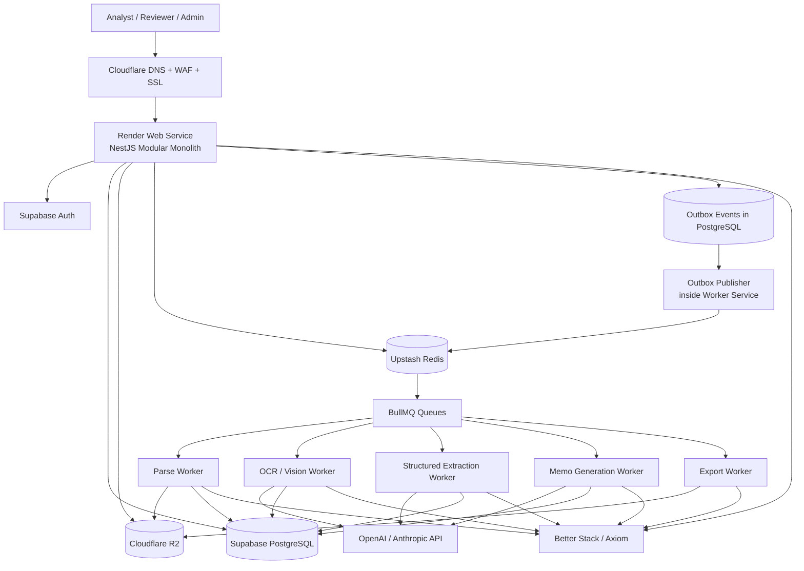
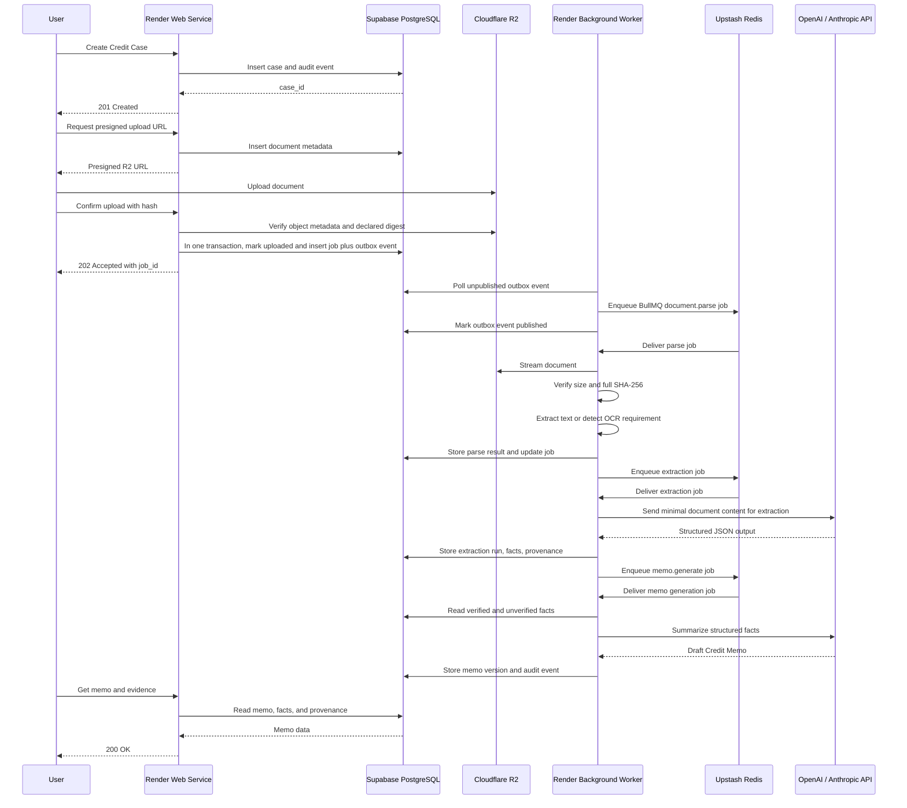
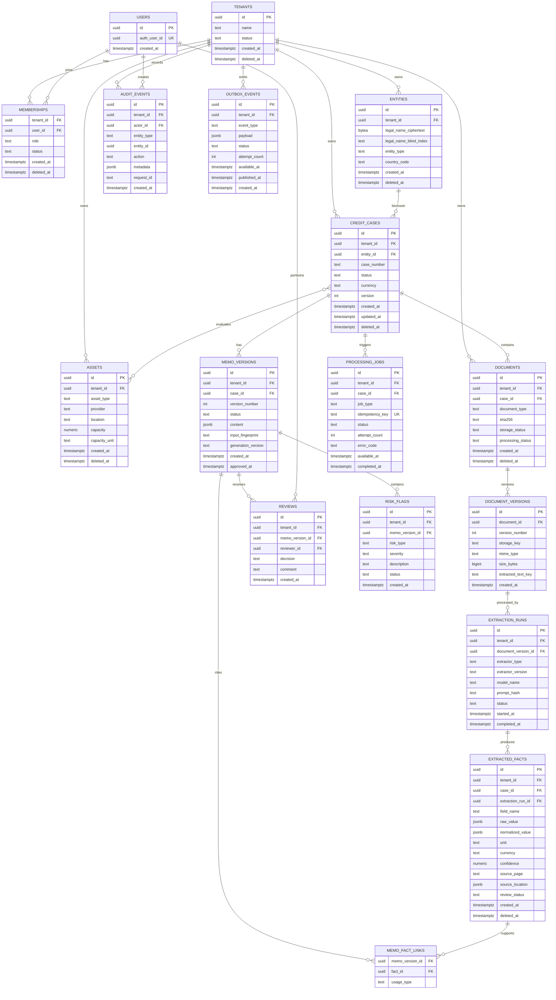

# Anvil — YC Winter 2027 Technical Foundation

## Recommendation

- Use a **modular monolith** with two independently deployed Render services:
  - `anvil-web`: NestJS HTTP API.
  - `anvil-worker`: NestJS background worker.
- Use **Supabase PostgreSQL + Supabase Auth**, Upstash Redis, Cloudflare R2, Render Blueprint, Cloudflare DNS/WAF/SSL, and Better Stack.
- Use LLM APIs only for:
  - OCR fallback.
  - Structured extraction.
  - Summarization.
- Do not train, fine-tune, host, or build foundation models.
- Target **$0 monthly infrastructure cost within free-tier quotas**.
- Important constraint: Render Free Tier may cold-start or sleep. Therefore:
  - `p95 < 200ms` applies to warm synchronous CRUD APIs.
  - Upload, parsing, LLM, memo generation, and export are asynchronous.
  - A strict always-on `99.9%` SLA cannot be guaranteed on free-tier infrastructure.

---

# 1. PROJECT NAME & VISION

## Project

**Anvil**

## Vision

> Convert fragmented GPU and robot lease documentation into structured, evidence-linked Credit Memos for financial underwriting.

## Core principles

- **Evidence-first**
  - Every material fact must link to a document, page, section, or source location.
- **Human-in-the-loop**
  - LLM output is a draft or extraction result, not an autonomous credit decision.
- **Low-operations architecture**
  - Managed free-tier services, modular monolith, asynchronous processing, and no self-managed infrastructure.

---

# 2. PRD — PRODUCT REQUIREMENTS DOCUMENT

## 2.1. Core problem

Credit underwriting data for physical infrastructure is usually spread across:

- PDFs.
- Lease contracts.
- Invoices.
- Bank statements.
- Financial spreadsheets.
- Utilization reports.
- Customer contracts.
- Email attachments.

The main operational problems are:

- Inconsistent formats.
- Missing fields.
- Conflicting numbers.
- Manual data entry.
- No consistent evidence trail.
- Slow Credit Memo preparation.
- Weak auditability.

## 2.2. MVP objectives

- Accept a set of documents for a GPU or robot financing case.
- Parse and classify documents asynchronously.
- Extract structured financial and operational facts.
- Preserve source provenance for each material fact.
- Generate a structured Credit Memo.
- Support analyst review, correction, approval, and rejection.
- Record all material changes in an append-only audit log.
- Operate on the required free-tier stack with minimal maintenance.

## 2.3. Out of scope for MVP

- Model training or fine-tuning.
- Autonomous credit approval.
- Loan origination or loan servicing.
- Payment processing.
- Accounting ledger.
- Bank transaction aggregation.
- Active-active multi-region deployment.
- Enterprise SSO and SOC 2 certification.
- Custom customer-hosted LLMs.

## 2.4. User personas

| Persona | Primary need | MVP permissions |
|---|---|---|
| Originator | Create cases and upload documents | Create and edit assigned cases |
| Credit Analyst | Validate facts and prepare memos | Read/edit facts and memos |
| Reviewer | Review risk and approve/reject memos | Review and approve |
| Tenant Admin | Manage tenant users and settings | Tenant administration |
| Auditor | Inspect evidence and history | Read-only |
| Viewer | Read approved memo content | Restricted read-only |

## 2.5. Core features

### A. Case management

- Create a `Credit Case`.
- Associate:
  - Borrower/entity.
  - GPU or robot assets.
  - Counterparties.
  - Documents.
- Case status:

```text
draft
documents_pending
processing
memo_ready
in_review
approved
rejected
archived
```

### B. Document intake

- Supported formats:
  - PDF.
  - PNG/JPEG.
  - CSV.
  - XLSX.
  - DOCX.
- Presigned Cloudflare R2 upload.
- SHA-256 duplicate detection.
- File size and MIME validation.
- Malware scanning hook.
- Document versioning.
- Document classification:
  - Lease.
  - Invoice.
  - Financial statement.
  - Bank statement.
  - Customer contract.
  - Utilization report.
  - Legal document.
  - Other.

### C. Async processing

- Upload confirmation creates a processing job.
- Processing occurs outside the API request path.
- Pipeline:
  - Text extraction.
  - OCR fallback.
  - Document classification.
  - Structured extraction.
  - Normalization.
  - Validation.
  - Conflict detection.
  - Memo generation.

### D. Structured extraction

Example fields:

- Revenue.
- Gross margin.
- Operating expenses.
- Debt.
- Lease cost.
- Asset cost.
- Capacity.
- Utilization.
- Customer concentration.
- Contract duration.
- Payment terms.
- Counterparty.
- Maintenance obligations.
- Insurance obligations.
- Default and termination conditions.

Each fact must include:

```text
field_name
raw_value
normalized_value
unit
currency
confidence
source_document_id
source_document_version_id
source_page
source_location
extraction_method
extraction_version
review_status
```

### E. Credit Memo generation

The MVP Credit Memo contains:

1. Executive summary.
2. Borrower/entity overview.
3. Asset profile.
4. Revenue and operating model.
5. Contract analysis.
6. Financial summary.
7. Debt and obligations.
8. Utilization and capacity.
9. Risk factors.
10. Mitigants.
11. Missing information.
12. Open questions.
13. Scenario assumptions.
14. Evidence index.
15. Reviewer comments.
16. Version history.

### F. Review workflow

- Edit extracted facts.
- Verify or reject facts.
- Mark a fact as:
  - `verified`
  - `unverified`
  - `needs_evidence`
  - `conflict`
  - `rejected`
- Add reviewer comments.
- Request additional documents.
- Approve or reject a memo version.
- Require an override reason for unresolved critical conflicts.

### G. Audit

Audit events are recorded for:

- Case creation and status changes.
- Document upload, replacement, and deletion request.
- Extraction run.
- Fact creation and modification.
- Memo generation.
- Memo approval/rejection.
- Permission changes.
- Data export.
- Administrative override.

## 2.6. MVP success metrics

### Product metrics

- Draft Credit Memo generated within **10 minutes** for a normal document bundle.
- At least **95% of critical fields** have source evidence in the golden test dataset.
- Reviewer can navigate from a material fact to its source in two interactions or fewer.
- No material mutation without an audit event.
- Manual correction rate decreases across extractor prompt versions.

### Technical metrics

- Warm synchronous API p95 `< 200ms`.
- Job success rate after retry `> 99%`.
- No committed database data loss.
- Target RPO `< 5 minutes`, subject to Supabase plan capabilities.
- Target RTO `< 30 minutes` for MVP operational recovery.
- Free-tier cost remains `$0` while quotas are not exceeded.

---

# 3. SRS — SOFTWARE REQUIREMENTS SPECIFICATIONS

## 3.1. Functional requirements

### FR-001 — Authentication

- Use Supabase Auth.
- Support email/password or magic-link authentication.
- Issue and validate JWT access tokens.
- Do not log access or refresh tokens.
- Disable access when the user or membership is disabled.

### FR-002 — Authorization

RBAC roles:

```text
tenant_admin
originator
analyst
reviewer
auditor
viewer
```

Authorization must check:

- User identity.
- Tenant membership.
- Resource ownership or assignment.
- Role permission.
- Case and memo state.

### FR-003 — Tenant isolation

- Every tenant-owned table contains `tenant_id`.
- Every repository query is tenant-scoped.
- RLS is enabled on tenant-owned tables.
- Cross-tenant access is covered by automated tests.

### FR-004 — Idempotency

Idempotency is required for:

- Upload confirmation.
- Processing job creation.
- Memo generation.
- Memo export.
- Reviewer approval.
- External provider callbacks.

Use:

```text
Idempotency-Key header
```

Persist idempotency records with:

```text
tenant_id
actor_id
key
request_hash
response_status
response_body
created_at
expires_at
```

### FR-005 — Document intake

- API issues a presigned R2 upload URL for a client-writable staging key; active reservations, hourly rates, tenant lifetime document count (1,000), and tenant lifetime ciphertext bytes (10 GiB) are capped under a tenant-scoped transaction lock.
- API returns one-time AES-256-GCM encryption material for that document and stores only the wrapped data key.
- Client encrypts the file before uploading ciphertext directly to R2; the presigned request binds the exact ciphertext length.
- Client confirms upload.
- At confirmation, the API verifies object existence, encrypted size, MIME type, signed digest metadata, and source ETag without downloading the file, reserves the server-only finalized key in PostgreSQL, then conditionally copies the ciphertext to that key. If the process stops before database confirmation, the cleanup worker knows both object keys and reclaims them after the reservation expires; failed-upload tombstones retry finalized-key deletion daily to catch late R2 copy completions.
- Workers read only finalized keys. The client URL cannot write to those keys; expired staging reservations and objects are removed by a bounded maintenance worker.
- The worker unwraps the per-document key, decrypts the stream, and verifies the plaintext SHA-256 before parsing; failed or unscanned documents never enter the extraction pipeline.
- Unscanned or failed documents cannot enter the LLM pipeline.

### FR-006 — Async job processing

- Heavy processing returns `202 Accepted`.
- Response includes `job_id`.
- Jobs expose status, progress, attempt count, error code, last error, worker version, and timestamps.

### FR-007 — Extraction

- Preserve original extraction output.
- Store normalized values separately.
- Store human corrections as a new version or correction event.
- Validate LLM output against a JSON schema.
- Invalid output must not be silently persisted as verified data.

### FR-008 — Memo versioning

- Each case can have multiple memo versions.
- Only one version can be current.
- Approved versions are immutable.
- Any post-approval edit creates a new version.
- Memo content must reference the fact and evidence versions used to generate it.

### FR-009 — Audit

- Audit events are append-only.
- Application APIs cannot update or delete audit records.
- Audit records contain actor, tenant, entity, action, request ID, timestamp, and before/after metadata or hashes.
- Sensitive values are redacted or hashed.

### FR-010 — Error handling

- Use stable application error codes.
- Return safe client-facing messages.
- Include `request_id` in every error response.
- Log internal stack traces with structured context.
- Never swallow exceptions.

## 3.2. Non-functional requirements

### Performance

- Warm CRUD API p95 `< 200ms`.
- Warm API p99 target `< 500ms`.
- No PDF parsing, OCR, or LLM call in an HTTP request.
- Use cursor pagination.
- Limit maximum page size.
- Avoid N+1 queries.
- Use database indexes and query-plan review.

### Security

- TLS for all external and internal connections.
- Supabase database encryption at rest.
- R2 server-side encryption.
- Upstash TLS.
- Application-level encryption for sensitive PII.
- KMS-backed encryption should be introduced when moving beyond the free-tier MVP.
- No secrets in source code or logs.
- No raw document content in logs.
- Least-privilege service credentials.

### Scalability

- API service is stateless.
- Worker service scales independently.
- Large files remain in R2, not API memory.
- PostgreSQL is the transactional source of truth.
- Redis stores temporary queue/cache state only.
- Database access is abstracted behind repositories.
- Worker concurrency is configurable through environment variables.

### Reliability

- At-least-once queue execution.
- Idempotent job handlers.
- Exponential retry with jitter.
- Dead-letter queue.
- Outbox pattern.
- Circuit breaker for LLM providers.
- Graceful shutdown.
- Dependency timeouts.
- Explicit degraded modes.

### Availability

- Render web service and worker are separate.
- Health checks distinguish liveness, readiness, and dependency health.
- Free-tier limitation:
  - Render service sleep/cold start may violate strict latency and availability targets.
  - Always-on production availability requires a paid plan.

### Maintainability

- SOLID.
- Dependency Injection.
- Interface-based external adapters.
- Controller/service/repository separation.
- Strict TypeScript.
- OpenAPI-generated documentation.
- Backward-compatible database migrations.
- Architecture Decision Records.

---

# 4. SYSTEM ARCHITECTURE

## 4.1. High-level architecture



## 4.2. Data flow



## 4.3. Component breakdown

| Component | Technology | Responsibility |
|---|---|---|
| DNS/WAF/SSL | Cloudflare Free | DNS, TLS, basic WAF |
| HTTP API | Render Web Service | Authentication context, CRUD, orchestration |
| Background processing | Render Background Worker | Outbox publisher and BullMQ consumers |
| Authentication | Supabase Auth | Login, JWT, user identity |
| Database | Supabase PostgreSQL | Cases, facts, memos, audit, jobs |
| Queue/cache | Upstash Redis | BullMQ queues, cache, short locks |
| Object storage | Cloudflare R2 | Original files, extracted text, exports |
| LLM extraction | OpenAI/Anthropic API | OCR fallback, extraction, summarization |
| Logging | Better Stack or Axiom | Structured log aggregation and alerts |
| Deployment | Render Blueprint | Declarative web and worker deployment |
| API documentation | OpenAPI/Swagger | Contract and developer documentation |

## 4.4. API design

### Principles

- REST/JSON.
- API prefix: `/v1`.
- OpenAPI-first.
- UUID or ULID identifiers.
- UTC timestamps.
- Cursor pagination.
- `Problem Details` error format.
- `Idempotency-Key` for side-effecting requests.
- `X-Request-ID` propagation.
- No direct exposure of database models.

### Main endpoints

```text
POST   /v1/cases
GET    /v1/cases
GET    /v1/cases/:caseId
PATCH  /v1/cases/:caseId
POST   /v1/cases/:caseId/archive

POST   /v1/cases/:caseId/documents/presign
POST   /v1/documents/:documentId/confirm-upload
GET    /v1/documents/:documentId
GET    /v1/documents/:documentId/versions

GET    /v1/jobs/:jobId
POST   /v1/jobs/:jobId/retry

POST   /v1/cases/:caseId/memos/generate
GET    /v1/cases/:caseId/memos
GET    /v1/memos/:memoId
GET    /v1/memos/:memoId/evidence

PATCH  /v1/facts/:factId
POST   /v1/facts/:factId/verify
POST   /v1/facts/:factId/flag-conflict

POST   /v1/memos/:memoId/approve
POST   /v1/memos/:memoId/reject

GET    /v1/cases/:caseId/audit-events
POST   /v1/memos/:memoId/exports
GET    /v1/exports/:exportId

GET    /health/live
GET    /health/ready
GET    /health/dependencies
```

## 4.5. Render Blueprint

```yaml
services:
  - type: web
    name: anvil-web
    runtime: node
    plan: free
    buildCommand: npm ci && npm run build
    startCommand: npm run start:web
    healthCheckPath: /health/ready
    envVars:
      - key: NODE_ENV
        value: production
      - key: DATABASE_URL
        sync: false
      - key: SUPABASE_URL
        sync: false
      - key: SUPABASE_ANON_KEY
        sync: false
      - key: UPSTASH_REDIS_URL
        sync: false
      - key: UPSTASH_REDIS_TOKEN
        sync: false
      - key: R2_ENDPOINT
        sync: false
      - key: R2_ACCESS_KEY_ID
        sync: false
      - key: R2_SECRET_ACCESS_KEY
        sync: false
      - key: LLM_PROVIDER
        value: openai
      - key: LLM_API_KEY
        sync: false

  - type: worker
    name: anvil-worker
    runtime: node
    plan: free
    buildCommand: npm ci && npm run build
    startCommand: npm run start:worker
    envVars:
      - key: NODE_ENV
        value: production
      - key: DATABASE_URL
        sync: false
      - key: SUPABASE_URL
        sync: false
      - key: SUPABASE_SERVICE_ROLE_KEY
        sync: false
      - key: UPSTASH_REDIS_URL
        sync: false
      - key: UPSTASH_REDIS_TOKEN
        sync: false
      - key: R2_ENDPOINT
        sync: false
      - key: R2_ACCESS_KEY_ID
        sync: false
      - key: R2_SECRET_ACCESS_KEY
        sync: false
      - key: LLM_PROVIDER
        value: openai
      - key: LLM_API_KEY
        sync: false
```

### Blueprint considerations

- Do not commit secrets in `render.yaml`.
- Use Render environment groups or dashboard-managed secrets.
- Use a restricted worker credential.
- Rotate LLM and storage credentials.
- Validate that the selected Render plan supports the required background worker behavior.

---

# 5. TECHNICAL ARCHITECTURE

## 5.1. Backend structure

```text
src/
├── main.ts
├── worker.ts
├── app.module.ts
│
├── config/
│   ├── app.config.ts
│   ├── database.config.ts
│   ├── redis.config.ts
│   ├── r2.config.ts
│   ├── llm.config.ts
│   └── validation.ts
│
├── common/
│   ├── errors/
│   │   ├── app-error.ts
│   │   ├── error-codes.ts
│   │   └── exception.filter.ts
│   ├── logging/
│   │   ├── logger.interface.ts
│   │   ├── pino.logger.ts
│   │   └── redact-fields.ts
│   ├── auth/
│   │   ├── jwt.guard.ts
│   │   ├── tenant-context.ts
│   │   └── roles.decorator.ts
│   ├── pagination/
│   ├── idempotency/
│   ├── tracing/
│   └── validation/
│
├── modules/
│   ├── auth/
│   │   ├── controllers/
│   │   ├── services/
│   │   ├── policies/
│   │   └── auth.module.ts
│   ├── tenants/
│   │   ├── controllers/
│   │   ├── services/
│   │   ├── repositories/
│   │   └── tenants.module.ts
│   ├── cases/
│   │   ├── controllers/
│   │   ├── services/
│   │   ├── repositories/
│   │   ├── models/
│   │   ├── dto/
│   │   ├── policies/
│   │   └── cases.module.ts
│   ├── documents/
│   │   ├── controllers/
│   │   ├── services/
│   │   ├── repositories/
│   │   ├── storage/
│   │   ├── scanners/
│   │   ├── parsers/
│   │   └── documents.module.ts
│   ├── extraction/
│   │   ├── controllers/
│   │   ├── services/
│   │   ├── extractors/
│   │   ├── normalizers/
│   │   ├── validators/
│   │   ├── provenance/
│   │   └── extraction.module.ts
│   ├── memos/
│   │   ├── controllers/
│   │   ├── services/
│   │   ├── repositories/
│   │   ├── renderers/
│   │   └── memos.module.ts
│   ├── reviews/
│   │   ├── controllers/
│   │   ├── services/
│   │   ├── policies/
│   │   └── reviews.module.ts
│   ├── jobs/
│   │   ├── controllers/
│   │   ├── producers/
│   │   ├── processors/
│   │   ├── state-machine/
│   │   ├── retry-policy/
│   │   └── jobs.module.ts
│   ├── audit/
│   │   ├── services/
│   │   ├── repositories/
│   │   └── audit.module.ts
│   └── outbox/
│       ├── services/
│       ├── repositories/
│       └── outbox.module.ts
│
├── infrastructure/
│   ├── database/
│   │   ├── migrations/
│   │   ├── connection.ts
│   │   ├── transaction-manager.ts
│   │   └── repositories/
│   ├── redis/
│   ├── queue/
│   ├── r2/
│   ├── llm/
│   ├── ocr/
│   └── observability/
│
└── workers/
    ├── outbox-publisher.worker.ts
    ├── document-parse.worker.ts
    ├── document-ocr.worker.ts
    ├── extraction.worker.ts
    ├── memo.worker.ts
    └── export.worker.ts
```

## 5.2. Clean architecture rules

### Controllers

- Parse and validate requests.
- Call application services.
- Map application errors to HTTP responses.
- Do not contain business rules.

### Services

- Implement use cases.
- Control transaction boundaries.
- Enforce business rules.
- Call repositories and adapters via interfaces.

### Repositories

- Define persistence interfaces.
- Enforce tenant scope.
- Avoid exposing ORM/database models to domain logic.
- Use explicit joins and batch loading.

### Infrastructure adapters

- PostgreSQL.
- Supabase Auth.
- Upstash Redis.
- BullMQ.
- Cloudflare R2.
- OpenAI/Anthropic.
- Better Stack/Axiom.

## 5.3. Interface-based design

```typescript
export interface DocumentParser {
  parse(input: ParseDocumentInput): Promise<ParsedDocument>;
}

export interface OcrProvider {
  extractText(input: OcrInput): Promise<OcrResult>;
}

export interface LlmExtractionProvider {
  extract(input: ExtractionInput): Promise<ExtractionResult>;
}

export interface MemoGenerator {
  generate(input: MemoGenerationInput): Promise<GeneratedMemo>;
}

export interface DocumentRepository {
  findById(
    tenantId: string,
    documentId: string,
  ): Promise<Document | null>;

  save(document: Document): Promise<void>;
}
```

Implementations:

```text
DocumentParser
├── PdfTextParser
├── SpreadsheetParser
└── FakeDocumentParser

OcrProvider
├── OpenAiVisionOcrProvider
├── AnthropicVisionOcrProvider
└── FakeOcrProvider

LlmExtractionProvider
├── OpenAiExtractionProvider
├── AnthropicExtractionProvider
└── FakeExtractionProvider
```

## 5.4. Database schema

### Design principles

- PostgreSQL is the source of truth.
- Core transactional entities follow 3NF.
- JSONB is limited to raw provider output, rendered memo snapshots, and flexible source-location metadata.
- Frequently queried fields use typed columns.
- All tenant-owned records include `tenant_id`.
- All business tables support soft delete where applicable.
- Audit events are append-only.

### ERD



## 5.5. Index strategy

### Cases

```sql
CREATE INDEX idx_cases_tenant_status_created
ON credit_cases (tenant_id, status, created_at DESC)
WHERE deleted_at IS NULL;

CREATE INDEX idx_cases_tenant_entity
ON credit_cases (tenant_id, entity_id)
WHERE deleted_at IS NULL;
```

### Documents

```sql
CREATE INDEX idx_documents_tenant_case_created
ON documents (tenant_id, case_id, created_at DESC)
WHERE deleted_at IS NULL;

CREATE INDEX idx_documents_tenant_hash
ON documents (tenant_id, sha256);
```

### Facts

```sql
CREATE INDEX idx_facts_case_field
ON extracted_facts (tenant_id, case_id, field_name)
WHERE deleted_at IS NULL;

CREATE INDEX idx_facts_case_review_status
ON extracted_facts (tenant_id, case_id, review_status)
WHERE deleted_at IS NULL;
```

### Jobs and outbox

```sql
CREATE INDEX idx_jobs_status_available
ON processing_jobs (status, available_at);

CREATE INDEX idx_outbox_status_available
ON outbox_events (status, available_at);
```

### Query rules

- Use joins or batch loading for case details.
- Never query one fact per memo section.
- Use cursor pagination.
- Run `EXPLAIN ANALYZE` on critical queries.
- Monitor slow queries.
- Add indexes based on measured access patterns, not speculation.

## 5.6. Row-Level Security

### Tenant membership helper

```sql
CREATE OR REPLACE FUNCTION is_tenant_member(target_tenant_id uuid)
RETURNS boolean
LANGUAGE sql
STABLE
AS $$
  SELECT EXISTS (
    SELECT 1
    FROM memberships m
    WHERE m.tenant_id = target_tenant_id
      AND m.user_id = auth.uid()
      AND m.status = 'active'
  );
$$;
```

### Example policy

```sql
ALTER TABLE credit_cases ENABLE ROW LEVEL SECURITY;

CREATE POLICY credit_cases_tenant_select
ON credit_cases
FOR SELECT
USING (is_tenant_member(tenant_id));

CREATE POLICY credit_cases_tenant_insert
ON credit_cases
FOR INSERT
WITH CHECK (is_tenant_member(tenant_id));
```

### RLS rules

- Enable RLS on all tenant-owned tables.
- Do not allow client-provided tenant context without membership validation.
- Worker operations must still pass tenant scope through the job payload.
- Do not expose the Supabase service-role key to the browser.
- Service-role access is restricted to the Render worker.
- Add automated cross-tenant access tests.

## 5.7. Queue and async processing

### Queue names

```text
document.ingest
document.parse
document.ocr
document.extract
memo.generate
memo.export
notification.send
```

### Job lifecycle

```text
queued
→ processing
→ succeeded
```

Failure path:

```text
processing
→ retry_wait
→ processing
→ failed
→ dead_letter
```

### Outbox pattern

The API writes the business state and event in one database transaction:

```sql
BEGIN;

INSERT INTO processing_jobs (...);

INSERT INTO outbox_events (
  tenant_id,
  event_type,
  payload,
  status
)
VALUES (
  $tenant_id,
  'document.upload_confirmed',
  $payload,
  'pending'
);

COMMIT;
```

The worker then:

1. Reads pending outbox events.
2. Claims an event using a lock or status transition.
3. Publishes the corresponding BullMQ job.
4. Marks the outbox event as published.
5. Retries failed publications.
6. Moves permanently failed events to an operational dead-letter state.

### Retry policy

Retry transient failures:

- Provider timeout.
- HTTP 429.
- Network error.
- Temporary database failure.
- Temporary R2 failure.

Do not retry indefinitely.

Suggested policy:

```text
max_attempts: 3
backoff: exponential
jitter: enabled
```

Permanent failures:

- Corrupt file.
- Unsupported file type.
- Invalid schema.
- Permission failure.
- Missing required source object.

### Idempotency

Job key:

```text
sha256(
  tenant_id +
  document_version_id +
  job_type +
  extractor_version +
  model_version
)
```

Before processing, the worker checks:

- Existing completed job.
- Existing extraction run.
- Existing memo with the same input fingerprint.
- Existing export with the same requested version.

Duplicate messages must produce no duplicate business side effects.

## 5.8. Security model

### Encryption

#### Platform-level

- Supabase PostgreSQL encryption at rest.
- Cloudflare R2 encryption at rest.
- Upstash Redis TLS.
- HTTPS through Cloudflare.
- Encrypted Render environment variables.

#### Application-level

Encrypt sensitive fields such as legal names, email addresses when required, phone numbers, bank account information, sensitive financial identifiers, and contract-sensitive values. Encrypt raw underwriting documents before they reach R2.

Recommended pattern:

```text
plaintext
→ application data encryption key
→ ciphertext
→ encrypted data key
```

MVP implementation:

- Use a managed secret as the root encryption secret.
- Implement authenticated encryption such as AES-256-GCM.
- Use a per-document data key for client-side file encryption; return it only to the authenticated uploader and never expose the root key.
- Store ciphertext and nonce separately from the key.
- Use key version identifiers.
- Add blind indexes for exact lookup.

Enterprise implementation:

- Replace the root secret with KMS-backed envelope encryption.
- Support key rotation and customer-managed keys.

### PII handling

- Do not send unnecessary PII to the LLM provider.
- Redact or tokenize PII before extraction where possible.
- Keep raw files in R2.
- Send only the relevant page or text chunk.
- Do not include raw PII in logs.
- Apply retention rules to temporary extracted text.
- Do not use customer documents for provider training where provider controls allow opt-out.

### LLM controls

- LLM API is an external adapter.
- No model training.
- No fine-tuning.
- No self-hosted foundation model.
- Validate output with JSON Schema.
- Store prompt version and model name.
- Store input fingerprint, not necessarily the full prompt.
- Reject unverified output as a final credit fact.
- Use deterministic parsers before LLM calls when practical.

### Graceful degradation

| Failure | Degraded behavior |
|---|---|
| Redis unavailable | Read APIs bypass cache; jobs remain in outbox |
| LLM unavailable | Retry, then mark extraction for manual review |
| R2 unavailable | Keep document state pending; retry later |
| OCR failure | Preserve original file and mark `needs_manual_processing` |
| Worker restart | BullMQ re-delivers unfinished jobs |
| Read replica lag | Read from primary for consistency-sensitive operations |
| Better Stack unavailable | Continue application execution; retain local structured output |
| Duplicate message | Idempotency prevents duplicate results |

## 5.9. Testing strategy

### Target distribution: 220+ tests

| Test category | Target |
|---|---:|
| Domain and use-case unit tests | 120 |
| Repository and database integration tests | 45 |
| API and OpenAPI contract tests | 25 |
| Worker and queue integration tests | 15 |
| E2E tests | 15 |
| Reliability and failure-mode tests | 10 |
| **Total** | **230** |

### Unit tests

Cover:

- Case state transitions.
- Role policies.
- Tenant authorization.
- Fact normalization.
- Currency and unit conversion.
- Confidence thresholds.
- Conflict detection.
- Retry classification.
- Idempotency behavior.
- Memo section generation.
- Audit event creation.
- Encryption/decryption adapters.

### Integration tests

Use Testcontainers for:

- PostgreSQL.
- Redis.
- BullMQ.
- S3-compatible local storage.
- Database migrations.
- Transaction rollback.
- Outbox publisher.
- Repository queries.
- RLS behavior where test infrastructure supports Supabase-compatible policies.

### API tests

- Authentication failures.
- Cross-tenant access.
- Invalid DTOs.
- Idempotency replay.
- Optimistic locking.
- Pagination.
- Error response format.
- OpenAPI compatibility.

### E2E tests

Use Playwright with synthetic users:

1. Sign in.
2. Create a tenant and case.
3. Request upload URL.
4. Upload a synthetic document.
5. Confirm upload.
6. Wait for processing.
7. Review extracted facts.
8. Correct one fact.
9. Generate memo.
10. Approve memo.
11. Export memo.
12. Verify audit events.

### Synthetic dataset

Include:

- Text-based PDF.
- Scanned PDF.
- Multi-page financial table.
- Missing fields.
- Conflicting revenue values.
- Different currencies.
- Duplicate documents.
- Corrupt document.
- Unsupported document.
- Large document.
- Low-confidence OCR.
- Contract with termination clauses.

Do not use real customer documents in CI.

### LLM testing

- Use fake LLM adapters for deterministic unit tests.
- Use recorded responses for integration tests.
- Maintain versioned golden extraction cases.
- Run a small provider smoke test outside the main CI path.
- Never make the full test suite dependent on live LLM availability.

## 5.10. Logging and observability

### Structured log format

```json
{
  "level": "info",
  "event": "extraction_completed",
  "request_id": "req_123",
  "trace_id": "trace_456",
  "tenant_id_hash": "tenant_hash",
  "case_id": "case_789",
  "job_id": "job_456",
  "duration_ms": 4200,
  "provider": "openai",
  "status": "succeeded"
}
```

Never log:

- Access tokens.
- API keys.
- Encryption keys.
- Raw documents.
- Full prompts containing PII.
- Complete bank details.
- Complete legal identifiers.

### Metrics

- HTTP request rate.
- HTTP error rate.
- HTTP latency.
- Queue depth.
- Oldest job age.
- Job success/failure rate.
- Retry count.
- Dead-letter count.
- LLM provider error rate.
- LLM request duration.
- R2 failures.
- Database connection usage.
- Slow query count.
- Cache hit rate.

### Alerts

- API 5xx rate above threshold.
- Warm API p95 breach.
- Queue oldest job age increasing.
- Dead-letter queue non-zero.
- Repeated LLM provider failures.
- Database unavailable.
- Outbox backlog increasing.
- Worker heartbeat missing.
- Authentication failure spike.

---

# 6. SCALE-UP ROADMAP

## Phase 1 — MVP on Render and Free Tier

### Build now

#### Product

- Supabase Auth.
- Tenant and membership model.
- Case management.
- Presigned R2 upload.
- Document metadata and versioning.
- PDF text extraction.
- LLM OCR fallback.
- Structured extraction.
- Provenance links.
- Confidence and conflict flags.
- Credit Memo generation.
- Review workflow.
- Append-only audit log.
- JSON/HTML export.

#### Infrastructure

- Render Web Service.
- Render Background Worker.
- Supabase PostgreSQL.
- Supabase RLS.
- Upstash Redis.
- BullMQ.
- Cloudflare R2.
- Cloudflare DNS/WAF/SSL.
- Better Stack or Axiom.
- Render Blueprint.
- GitHub Actions CI/CD.

#### MVP operational rules

- Keep free-tier quotas visible.
- Set hard upload limits.
- Limit LLM calls per case.
- Limit document pages per job.
- Add provider timeouts.
- Add cost/usage counters.
- Do not process unlimited batch uploads.
- Use manual review when limits are exceeded.

### MVP trade-offs

| Decision | Reason |
|---|---|
| Modular monolith | Lower O&M cost and fewer deployment boundaries |
| Separate web and worker | Prevent PDF/LLM workloads from blocking API |
| Supabase Postgres | Managed PostgreSQL, Auth, and RLS in one platform |
| Upstash Redis | No self-managed Redis operations |
| Cloudflare R2 | Low-cost S3-compatible object storage |
| Render Blueprint | Declarative deployment with minimal infrastructure work |
| No microservices | Insufficient MVP scale to justify operational complexity |
| No model training | Faster delivery, lower cost, and lower technical risk |

## Phase 2 — Scale to 10x workload

### Compute

- Move Render services to always-on plans if latency and availability become contractual.
- Add separate worker services by workload:
  - Parse.
  - OCR.
  - Extraction.
  - Memo.
  - Export.
- Tune concurrency per queue.
- Add priority queues.
- Add worker autoscaling if supported by the selected deployment setup.

### Database

- Add read replica.
- Route read-only queries separately.
- Introduce connection pooling.
- Partition large audit tables.
- Add materialized summary views.
- Add query performance regression tests.
- Increase database plan when free-tier storage or compute becomes insufficient.

### Queue and processing

- Separate interactive and batch queues.
- Add queue cancellation.
- Add dead-letter replay tooling.
- Add tenant-level quotas.
- Add circuit breakers for LLM and OCR providers.
- Add provider fallback between OpenAI and Anthropic.

### Product

- Batch uploads.
- Case comparison.
- Configurable memo templates.
- Custom extraction fields.
- Reviewer workload dashboard.
- Scenario analysis.
- Better conflict resolution.

## Phase 3 — Enterprise

### Identity and access

- SSO/SAML.
- SCIM provisioning.
- Fine-grained permissions.
- Entity-level access policies.
- Privileged access workflow.
- Periodic access reviews.

### Compliance

Potential requirements, subject to customer and legal validation:

- SOC 2 Type I/II.
- ISO 27001.
- GDPR/CCPA.
- Data residency.
- Data processing agreements.
- Vendor risk management.
- Incident response.
- Business continuity.
- Immutable audit retention.
- Legal hold.

### Security

- KMS-backed envelope encryption.
- Customer-managed keys.
- BYOK.
- Private networking.
- DLP scanning.
- Advanced anomaly detection.
- Immutable audit archive.
- Centralized SIEM integration.

### Infrastructure

- Multi-region disaster recovery.
- Cross-region R2 replication.
- Warm standby region.
- Automated regional failover.
- Dedicated analytics warehouse.
- Event streaming only if workload justifies it.
- Service extraction only when a module has:
  - A distinct scaling profile.
  - Separate ownership.
  - Independent deployment needs.
  - Clear failure-isolation requirements.

---

# Final MVP acceptance checklist

## Product

- [ ] Case can be created.
- [ ] Documents can be uploaded to R2.
- [ ] Upload is verified and audited.
- [ ] Processing is asynchronous.
- [ ] Facts have provenance.
- [ ] Facts can be reviewed and corrected.
- [ ] Memo versions are generated.
- [ ] Approved memos are immutable.
- [ ] Exports are asynchronous.
- [ ] Audit history is visible.

## Architecture

- [ ] Web and worker services are separate.
- [ ] BullMQ runs on Upstash Redis.
- [ ] Outbox pattern is implemented.
- [ ] Retry and dead-letter behavior is tested.
- [ ] Idempotency is implemented.
- [ ] Graceful degradation is defined.
- [ ] Health endpoints exist.
- [ ] Render Blueprint deploys both services.

## Security

- [ ] Supabase Auth validates identity.
- [ ] RLS is enabled.
- [ ] Cross-tenant access tests pass.
- [ ] Sensitive PII is encrypted.
- [ ] Secrets are not committed.
- [ ] Raw documents are not logged.
- [ ] LLM input is minimized and redacted where possible.

## Testing

- [ ] 200+ tests exist.
- [ ] Testcontainers integration tests pass.
- [ ] Synthetic E2E dataset exists.
- [ ] Duplicate job tests pass.
- [ ] Worker restart tests pass.
- [ ] Provider timeout tests pass.
- [ ] RLS tests pass.
- [ ] Migration tests pass.

## Constraint validation

- [ ] Free-tier quotas are monitored.
- [ ] Upload and page limits are enforced.
- [ ] LLM usage limits are enforced.
- [ ] Cold-start impact is documented.
- [ ] The team has decided when to move from free tier to paid infrastructure.
